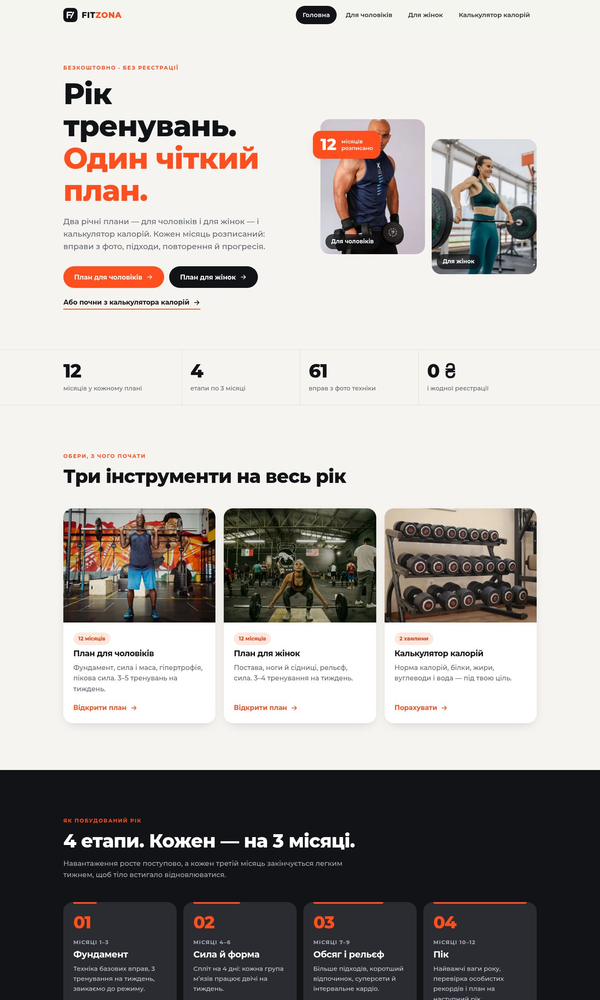
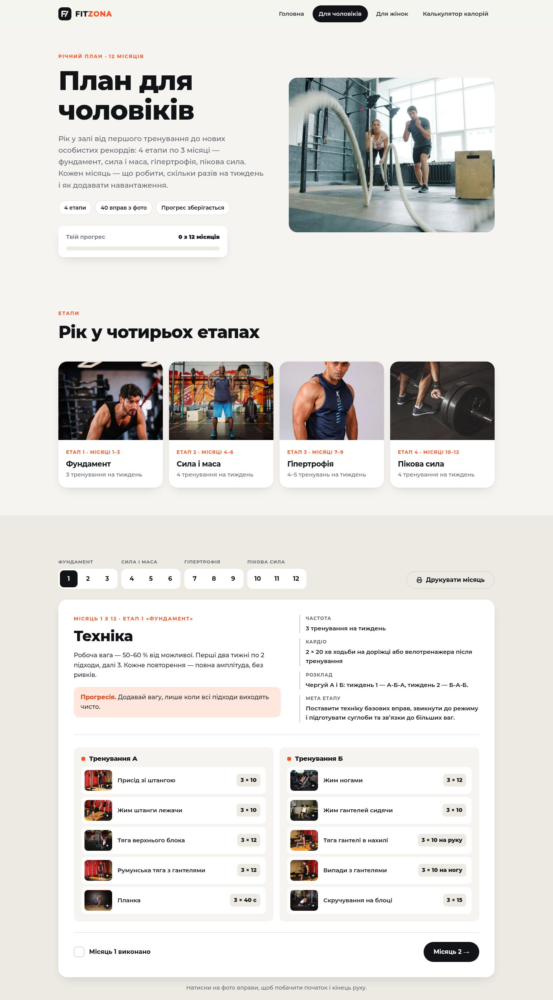
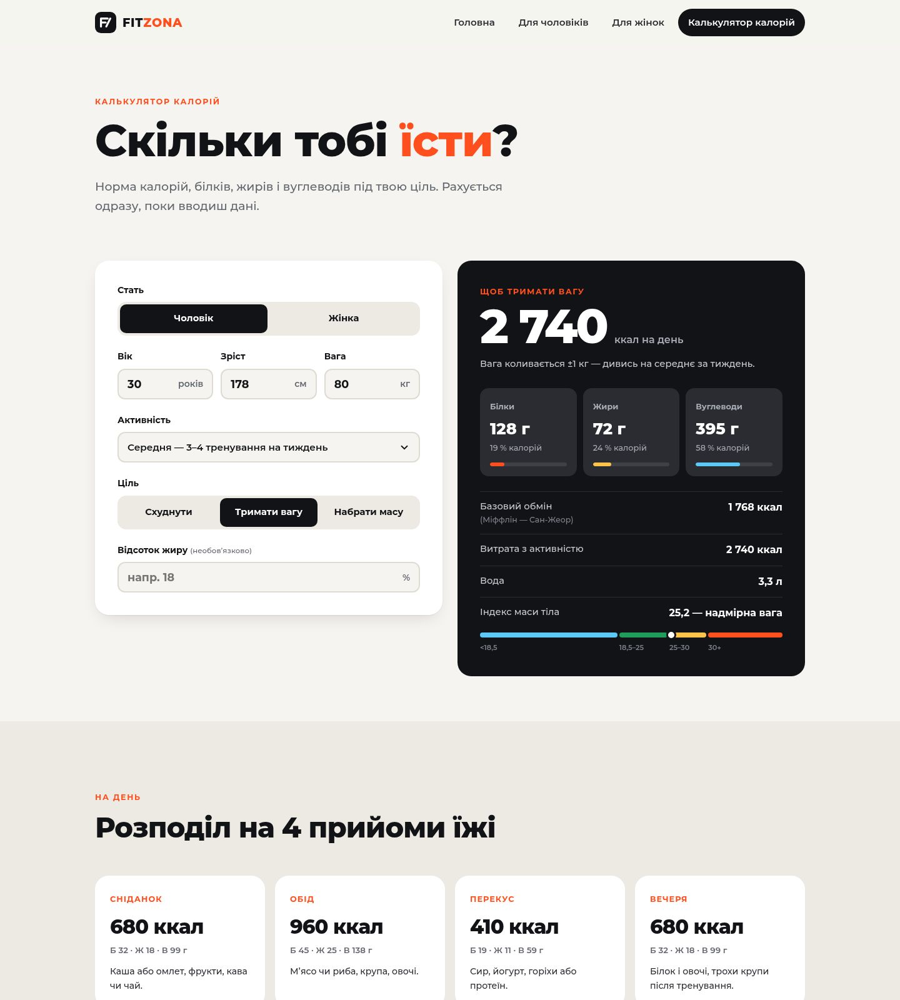

# Fit Zona — yearly training plans and calorie calculator

A static website (HTML, CSS, JavaScript) with two 12-month gym training plans — for men and for women — and a calorie calculator. The site content is in Ukrainian.

**Live:** https://fit-zona.pp.ua/

## Pages

| Page | What it does |
| --- | --- |
| `index.html` | Home: overview of the plans, the 4 phases of the year, rules, FAQ |
| `plan-dlya-cholovikiv.html` | 12-month plan for men |
| `plan-dlya-zhinok.html` | 12-month plan for women |
| `kalkulyator-kaloriy.html` | Calorie calculator |
| `404.html` | Not-found page |

### Training plans

- 4 phases of 3 months each; every month has its own goal, progression tip, training frequency, cardio and weekly schedule.
- Workouts as cards with sets × reps; 59 exercises have photos — click a thumbnail to see the start and end of the movement.
- "Month done" checkboxes with a progress bar, saved in the browser (`localStorage`).
- Month tabs with keyboard navigation and direct links (`#misyats-5`), print-friendly current month.

### Calorie calculator

- Mifflin–St Jeor formula, or Katch–McArdle when body-fat percentage is given.
- Activity level, goal (lose / maintain / gain) and pace.
- Daily calories, protein / fat / carbs in grams, BMR, TDEE, water, BMI with a scale, split into 4 meals.
- Safe minimum (1200 kcal for women, 1500 kcal for men). Inputs are saved in the browser.

### SEO

Canonical URLs, Open Graph / Twitter images (`assets/og`), JSON-LD (WebSite, FAQPage, ExercisePlan, WebApplication, BreadcrumbList), `sitemap.xml`, `robots.txt`, real 404 page.

## Project structure

```
_build/
  build.py        site generator
  plans.py        plan data (exercises, sets, monthly notes)
  photos/         source photos (Pexels)
  ex-img/         exercise frames (free-exercise-db)
  fonts/          full Montserrat TTF used to draw social images
fit-zona/         the built site — upload this folder to the server
  assets/css, assets/js   hand-written styles and scripts
  assets/fonts            Montserrat (Cyrillic + Latin subsets, WOFF2)
  assets/img, assets/ex, assets/og   generated images
```

## Build

Requires Python 3 with Pillow.

```
python3 _build/build.py
```

The script generates the HTML pages from `_build/plans.py`, converts photos and exercise frames to WebP, draws the social images and writes `sitemap.xml` and `robots.txt`. CSS and JS in `fit-zona/assets` are edited by hand.

Run locally:

```
python3 -m http.server 8140 -d fit-zona
```

Then open http://localhost:8140/.

## Screenshots





## Credits and licences

- Montserrat font — SIL Open Font License 1.1 (`fit-zona/assets/fonts/OFL.txt`)
- Photos — [Pexels](https://www.pexels.com/license/)
- Exercise frames — [free-exercise-db](https://github.com/yuhonas/free-exercise-db) (Unlicense, public domain)

The plans and calculator are general guidance for healthy adults, not medical advice.

Design & Development by [Sasha Zimin](https://zimin.dev) ❤️
